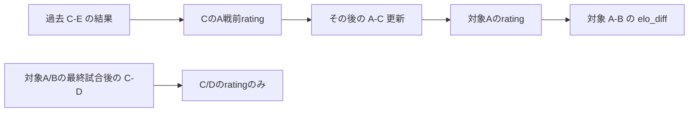

# Champion A：日数ベース先行予測の依存性調査

判定：`CHAMPION_A_EARLY_PREDICTION_POLICY_READY`。
固定モデルの依存性、判定条件、保存互換性、次の実装ゲートが明確になった**設計判定**である。
現行 `prediction_history_incomplete`、既存予測、タスク、GUIは変更せず、日曜の運用BLOCKEDは維持する。
実モデルload/推論、実データのElo値計算、予測保存、公式GETは0。

[政策案](CHAMPION_A_EARLY_PREDICTION_POLICY.md) と
[機械可読検証台帳](CHAMPION_A_EARLY_PREDICTION_VALIDATION.json) を併せて参照する。

## 基準と読み取った経路

- 本調査branch：`feature/champion-early-prediction-policy`。
- 基準：`ea494d8b2ac94ab42912cc4557e6c94317357326`（日曜実行前調査）。
- 正式updater：`5ac9052a221c6d8d563ec982bc48fbddb9e80bfa`。
- GUI：コード `1b660f1843323c0f0325a3fde43836c9e2445c94`、配備記録 `d21c4d206a69fc9e8aaea6d348e4964b54264b77`。
- Source：`5678e72ddb61a08cc88eea58fa8b3e8833aa3f4bc8c714a59e2bc9f54c9f033f`、観測10/24 07:00:22.614190 JST。

運用worktreeの `scripts/update_champion_dashboard.py` はcollector→日別選択→
`require_complete_history`→`predict_champion`→全日batch→表示投影の順。
`src/modeling/champion_prediction.py` はモデルを固定SHA検証し、
2015〜2025の3,588件、百年構想200件、approvedな通常J1完了結果を再生する。
モデル版は `operational_champion_20260922_v1`、scalerは固定、再fitしない。
保存済みmetadata、学習manifest、推論入力コードで、特徴量1列・class順・Elo設定が整合する。
実joblibをロードしたshape/ABI検証は今回行っていない。

## 全特徴量の依存性

| 特徴量・処理 | Champion Aで使用 | 依存するsource/状態 | 必要時点・変更の影響 |
|---|---|---|---|
| `elo_diff` | **使用する唯一の入力** | HOME/AWAYのrating差。固定学習履歴、百年構想、accepted通常J1の90分結果、TeamMaster | 両チームの過去対戦相手を含む時間順の依存閉包が必要。日程変更で更新順・対象履歴が変わり得る |
| 直近N試合/Form | 使用しない | 推論入力列にない | 将来追加するなら別の依存契約が必要 |
| HOME/AWAY別戦績 | 使用しない | 同上 | HOME/AWAYはElo更新のhome advantageとfixture向きにのみ関係する |
| 休養日数 | 使用しない | 同上 | カップ戦による疲労・休養はこのモデル入力に反映しない |
| 順位・リーグ平均・全チーム共通更新値 | 使用しない | 動的な順位/平均を読む経路がない | これらが将来入力になれば「他チーム試合だから無関係」は成立しない |
| 対戦履歴/H2H | 独立特徴量として使用しない | Elo履歴に過去対戦結果が含まれる | 過去結果の影響をEloから切り離して無視する意味ではない |
| 日程密度 | 使用しない | モデル列にない | 日程はidentity・順序・途中試合・cutoffの検証には使用する |
| 標準化 | 固定処理として使用 | 学習3,588件で固定した1列scaler | 実行時リーグ平均や当日batchで再fitしない。並べ替えで統計量は変わらない |
| 欠損補完 | 行わない | finiteなrating差と既知TeamMasterを要求 | 不明結果・不明チームを0/平均値で埋めない |
| `home advantage` | 履歴更新で使用 | 固定175、K30、初期1500 | 入力の差分自体へ175を足さない。generic Eloの既定K20と混同しない |

コード根拠は `champion_prediction::{load_champion,replay_ratings,probability_rows}` と
`src/features/elo.py::EloRatings.update`。`probability_rows` は7列の許可targetから
`ratings[home]-ratings[away]` だけを `(N,1)` floatへ変換し、固定scaler→モデルへ渡す。
結果列、順位、研究値を入力へ追加する経路はない。
`elo_history` の他の汎用builderをK30の正式Champion再生器へ置き換えない。
既存ID30700等の百年構想の順序・再開日処理も変更しない。

## Eloの局所性と間接依存

1試合の更新は、直前の両ratingだけから `delta=30*(score-expectation)` を計算し、
HOMEへdelta、AWAYへ負deltaを加える。第三者のrating、リーグ平均、順位は更新式に入らない。
**対象チームの最後の更新後に、別チーム同士だけが試合をしても、その対象ratingは変わらない。**

一方、対象Aの過去の相手Cが、その前にEと戦っていれば、C-Eの結果はA-Cの期待値を通じてAへ影響する。
「未完了試合にA/Bが出ていない」という判定だけでは安全ではない。

必要集合は対象HOME/AWAYから逆時系列にたどる。対象日より前の**全日程**を、completedだけに
間引かず参照し、必要teamが参加した試合を閉包へ追加して相手teamも必要集合へ加える。
必要試合が未完了・取得時刻不明ならHOLD。時間順の祖先へ到達しない未完了試合は別の不完全集合として保持する。
単なる全teamを結ぶ無向グラフではなく、各時点のrating依存である。
正式コードの「同一team・同一日重複拒否」を維持するため、同日別試合の順番に依存しない。

最初の実装では、**完全な過去prefix＋その後に対象teamの試合なし**という十分条件をfast pathにできる。
一般的な対象teamだけのゲートへ置き換えることは推奨しない。

## 現行ゲートの意味

`require_complete_history` は `match_date < target_date` かつ `status != completed` を全リーグで検出する。
依存グラフを見ているわけではなく、「未完了を黙って省いたElo」を防ぐ保守的な運用制約である。
その理由は妥当だが、固定Elo一列について全試合の結果が常に数学的に必要という意味ではない。

次は引き続き別ゲートとして残る。

- source観測≤実際のfreeze、鮮度24時間、raw/metadata/result provenance、公式revision整合。
- 既存7列target、全件identity・日程・TeamMaster、予測/commitのkickoff前、時計逆行拒否。
- 学習/百年構想の固定全履歴、結果/順序/同日team重複、固定scaler/modelの検証。
- 日別batchの完全性、既保存拒否、排他、source/保存前後SHA、正式readerの検証。

旧ゲートは今回変更していない。新しいpolicy候補を返しても、updaterが参照する関数ではない。

## 10/25の5件：保存済みsourceでの解析

観測calendarは380件。10/25より前の通常J1 prefixは115件（completed110、土曜未完了5）。
10/21までの110件が完了済みで、土曜の10チームと日曜の10チームは重ならない。
以下の「必要件数」は通常J1の時間依存閉包だけで、別途固定3,788件を全件維持する。
実Elo値・予測確率は計算していない。

| 公式ID（match_page） | HOME－AWAY | モデル対象の途中試合 | 直近必要結果日 | 閉包件数 | 解析判定 |
|---|---|---|---|---:|---|
| 102502 | 名古屋－横浜FM | なし | 10/21 | 91 | Elo依存条件の候補 |
| 102504 | C大阪－千葉 | なし | 10/21 | 90 | 同上 |
| 102503 | 浦和－長崎 | なし | 10/21 | 93 | 同上 |
| 102505 | FC東京－水戸 | なし | 10/21 | 91 | 同上 |
| 102506 | 川崎F－岡山 | なし | 10/21 | 91 | 同上 |

直近結果の公式Data Site IDは順にHOME/AWAY：34621/34619、34621/34626、34626/34625、
34617/34623、34618/34623。日曜のmatch_page namespaceとは別で、数値を交換しない。
必要結果の最後の実取得は10/22 07:00:14〜22.952930 JST。
日曜5件のidentity取得は10/23 07:00:08.912791〜21.798359 JST。
閉包IDの全リスト・必要結果UTC・source対応は非公開監査に保持し、公開台帳には件数と集合SHAを記録する。

このsourceで必要なElo履歴は閉じており、土曜の5結果がどの結果でも日曜の対象ratingを変えない。
ただし**全大会で途中試合がないことはUNKNOWN**。保存calendarは通常J1を網羅するもので、全カップ戦の
存在/不存在を証明しない。固定ChampionのEloはカップ戦を更新入力にしないため、モデル依存性上は別枠とする。
ユーザーが「特徴量と無関係でも全大会の途中試合を禁ずる」方針を選ぶなら、追加日程証拠が必要でHOLD。

## 最早時刻とPITの限界

最古の保存済み候補revisionは `ec06f50fe01d7d68206204d67272675160de795ac59f5873eb419413f64c25ca`、
観測は10/23 07:00:21.798359 JST。各fixtureの必要結果とidentityがそろう取得時刻下限を記録できる。
しかしpublication完了receiptがないため、**当時の最早の予測実行可能UTCはUNKNOWN**。
観測時刻、mtime、manifest作成時刻を公開完了時刻へ代用しない。
共通sourceを使うなら、個々のID取得よりも全sourceが取得・検証・公開済みであることが必要。

この最古候補は金曜07:00を21.798359秒過ぎており、Weekend Batchの金曜07:00固定cutoffには使えない。
今回の案は実freezeを使う日数ベースの別policyで、過去07:00の予測を後付けする案ではない。
本調査時点のsource観測は10/24 07:00:22 JSTで鮮度内、対象は10/25 14〜16時JST。
新policyの実装・承認前に予測は作らず、実行時に同じ条件を再確認する。

## 検証と保護

`research/champion_early_prediction_policy.py` は標準libraryだけの純粋な設計試作。
ファイル読書き、network、collector/model import、CLI、運用有効化機能を持たない。
`candidate` は条件付き解析結果であり、`execution_authorized` と `history_admission` は常にfalse。
証拠検証済みという入力flagそのものは証拠ではなく、将来の実装が原本から検証すべき前提を表す。

新規43 PASS。別チーム5試合の3^5＝243結果組合せで対象差分不変を合成Eloで確認し、
間接依存の反例、全体特徴量、日時、延期/中止、cup、coverage、SHA、固定入力改変を検証した。
関連回帰は251 PASS、warnings-as-errors、FAIL/skip 0。socket bindとNode子processの既存2件は
非実行scopeとしてdeselectし、PASSに加算していない。過去の配備テスト件数も加算しない。

保護baselineは69,585ファイル・既存28 worktree。hash/identity/size/mtime/creation、モデル53 payload、
既存19予測、公式原本・receipt、NN/Weekend Batch、main、Desktop、GUI/server、タスクを比較する。
最終結果は検証台帳に記録する。実行コード・原本は変更せず、独立branchの調査成果だけを保存する。
