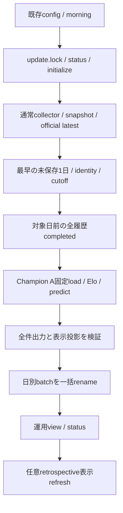

# Champion A：2026-10-25 日曜5試合の実行前調査

最終判定：`CHAMPION_A_SUNDAY_PREDICTION_BLOCKED`。
**調査・計画は完了したが、現在の保存sourceでは実予測を開始できない。**
対象日より前の土曜5試合がすべて `scheduled` のままで、正式日別workerの
`prediction_history_incomplete` が成立する。ゲートを緩めず、新しい完了証拠を待つ。
今回は公式取得、実モデルload/predict、保存、snapshot更新、GUI再起動を行っていない。

機械可読集計は [調査台帳](CHAMPION_A_SUNDAY_PREDICTION_PREFLIGHT.json)、
個別承認の順序は [実行計画](CHAMPION_A_SUNDAY_PREDICTION_EXECUTION_PLAN.md) を参照する。

## 1. 固定したコード・現在の観測

| 対象 | Revision / 状態 |
|---|---|
| 正式運用updater | `5ac9052a221c6d8d563ec982bc48fbddb9e80bfa`、運用専用worktree |
| GUI実行コード | `1b660f1843323c0f0325a3fde43836c9e2445c94` |
| GUI配備記録 | `d21c4d206a69fc9e8aaea6d348e4964b54264b77`、`feature/ui-weekend-deployment` |
| 本調査 | 上記GUI配備記録から独立した `feature/champion-sunday-preflight` |
| GUI | effective launcher PID10872 / server PID556、`http://127.0.0.1:51502/` |

PIDだけでなくcreation time、exe、引数、Owner SID/session、親子関係、kernel mutex/Event、
listenerを再照合した。GUI、Desktop入口、pair、対象外serverは変更しない。
このPID/portは観測値であり、将来の操作では再確認する。

07:00/22:00タスクはReady。午前の直近実行は2026-10-24 07:00:01 JST、結果1、
夜間は10/23 22:00:01 JST、結果0。次回予定は10/24 22:00と10/25 07:00。
定義はInteractiveToken/Limited、IgnoreNew、15分上限。予定時刻を実取得・保存時刻とみなさない。
タスクを変更・手動実行せず、失敗を修復しない。

## 2. 公式対象の独立確認

保存済みの最新accepted publicationは以下のとおり。

- Revision：`5678e72ddb61a08cc88eea58fa8b3e8833aa3f4bc8c714a59e2bc9f54c9f033f`
- Manifest SHA：`5e6d370c0eaeee8d0bca676c7d8dc3b75fabb12cf7c03c7372a34ddff9f37f3e`
- Observation：`2026-10-23T22:00:22.614190+00:00`（10/24 07:00:22.614190 JST）
- `ongoing-v2` / `official-game-over-v1`、全380件、完了110件。

GUIの5行を根拠にせず、公式schedule/identity、TeamMaster、raw/metadata、保存batchから確認した。
全5件は2026/27 J1の公式第12節、`scheduled`、結果空欄、保存済み予測0件。
namespaceは全件 **`jleague_match_page`**。Data Site IDは空欄であり、6桁値をData Site IDへ転用しない。

| 公式match_page ID | kickoff（2026-10-25 JST） | HOME | AWAY | fixture key末尾 |
|---|---|---|---|---|
| 102502 | 14:00 | 名古屋グランパス | 横浜F・マリノス | `nagoya:yokohamafm` |
| 102504 | 15:00 | セレッソ大阪 | ジェフユナイテッド千葉 | `cosaka:chiba` |
| 102503 | 15:00 | 浦和レッズ | V・ファーレン長崎 | `urawa:nagasaki` |
| 102505 | 16:00 | FC東京 | 水戸ホーリーホック | `ftokyo:mito` |
| 102506 | 16:00 | 川崎フロンターレ | ファジアーノ岡山 | `kawasakif:okayama` |

完全なkeyは `j1_2026_2027:` を前置する。両クラブのTeamMaster IDはJSON台帳に記録。
保存19revisionの当該行は同じ日付・kickoff・開催状態。change_logの重複をevent IDで除くと
新規fixture/identity_linkedだけで、当該5件の日程変更イベントはない。
これは未取得の公式変更告知や今後の変更が存在しないという証明ではない。
ID根拠ページの取得UTCは10/22 22:00:08〜21 UTCで、snapshotとraw/metadata SHAを照合した。
`official_completion_unconfirmed` は未開催ページのidentity証拠であり、終了証拠ではない。

## 3. PIT・実行期限

| 条件 | 今回の結果 |
|---|---|
| 5件のfixture/typed identity・日時 | PASS（保存済みsourceの範囲） |
| 保存済み予測との重複 | 0件、日曜batchなし |
| 対象日以前の公式履歴完全性 | **BLOCKED：10/24の5件がscheduled** |
| source鮮度 | 読取り時約8.92時間、現行24時間上限内。実行時に再判定必須 |
| 対象kickoff | 全件未来。最初は10/25 14:00 JST＝05:00 UTC |
| 将来の実行UTC・生成UTC・保存UTC | 未実行のため未確定、過去時刻を割り当てない |

正式日別契約は金曜07:00固定snapshot方式ではない。source観測≤予測開始、source age≤24時間、
対象日より前の全公式試合completed、予測生成・commit検査が各kickoffより厳密に前、
時計逆行なしを要求する。土曜結果が予測前に実取得・検証済みなら日曜Eloへ使用できる。
未終了結果を先取りしたり、現在の結果を金曜時点へ持ち込んだりしてよいという意味ではない。
今回のsourceは明日07:00:22.614190 JSTを越えると24時間超となるため、そのまま明朝の成功を保証しない。

履歴110件の保存済み明示的game-over原本と90分結果を再解析した。12 snapshotの148 source entryで
raw/metadata SHAと取得完了UTCを確認。133件にrequest開始UTCがあり、旧15件は未記録として保持する。
publication完了UTCもmanifest/mtimeから捏造しない。既存日別契約の成立と、NN v2のB/C/Dや
金曜07:00のreceipt契約の成立は別であり、研究側HOLDを解消したと扱わない。

5件ではidentity証拠とcompletion originが異なるsnapshotを参照し、そのうち4件でraw/UTCも異なる。
publisherのbridge処理がidentity側のevidenceフィールドを保持するコードを確認したうえで、
**両方の原本**に明示的終了と同じ90分結果があることを照合した。最初の一対一対応を仮定した
監査assertionの失敗は保全し、2種類の参照を混同せず記録した。sourceやruleは変更していない。
実際の終了時刻、物理的中断の不存在、当時のpublication完了時刻は推測しない。

## 4. 正式実行入口・モデル

実行入口は運用worktreeの `scripts/update_champion_dashboard.py::main`。
CLIは **`--config <既存設定> --slot morning|evening` のみ**。`--date`、`--target-date`、
`--no-collect`、予測だけのCLIは存在しない。`morning` はcollectorを先に実行し、
JST当日〜2日先の最も早い未保存開催日を1日分選ぶ。`evening` の予測生成は0。

collectorは公式一覧、discovery、未完了ページを取得し、raw/metadata、snapshot、公式revision、
latest、診断を保存する。現configはdiscovery最大6、evidence最大20、取得budget600秒、1秒待機、
socket/stream各30秒、8 MiB/body。論理fetch呼出し上限は一覧1＋検索6＋詳細20＝27。
標準urllibのredirect追従があり得るため、これを厳密な実HTTP GET上限27とは扱わない。
予定5試合だけの推論と、取得が5 URLだけで済むことは別である。
現configは任意retrospective displayも有効で、通常CLIの副作用を日曜batchだけと説明してはいけない。
CLI returnは成功0、catchした例外1、引数不正2。失敗時もsource公開やstatus等は既に変わり得る。

Champion版は `operational_champion_20260922_v1`。
bundle SHAは `2d2e50dbfc4d71ec2cdaf5fe1a6e48953c160c388f1740cfe538f29f593646d1`。
model/scaler/metadata/training manifest/checksumsの5 SHA、固定data12ファイル、百年構想履歴SHAを
静的照合した。実モデルはdeserializeしていない。宣言された環境と実ロード時のABI・数値動作は別ゲート。

入力はtyped fixtureの7列、モデル入力はfloat `(N,1)` の `elo_diff` だけ。
Elo初期1500、K30、home advantage175、resetなし。HAは履歴更新に使用し、入力差分へ175を加えない。
2015〜2025、百年構想、対象日より前のapproved通常J1結果をreplayする。
固定scaler.transform→LogisticRegression.predict_proba、class順 `(0,1,2)=(Away,Draw,Home)`。
有限、0〜1、和1を検証する。fit・scaler再fit・自動モデル更新は行わない。

## 5. 保存契約と案の比較

正本は既存runtimeの `batches/<SHA256(sorted fixture keys joined by newline)>/`。
`predictions.csv`、`bindings.csv`、両SHAの `manifest.json` が旧日別形式である。
新しいprediction UUIDはなく、fixture key、namespace付きprediction match ID、モデル版、
source/witness revision・manifest SHA、生成UTCで識別する。GUI確率は保存0〜1値の表示百分率。

現在19件（10/09:2、10/18:2、10/21:10、10/24:5）。日曜0件。
日別選択は部分既保存を拒否し、全既保存なら推論しない。排他はcallerの `update.lock` が担う。
`publish_batch` 単独は全既存fixture重複の検証器ではなく、直接呼出す近道は不可。
新規同volume staging内で全CSV/manifestをflush後directory renameする。既存destinationを拒否する。
batch公開後にfeedが失敗してもbatchは残る。source・batch・view全体の一つのtransactionではない。
lock markerはPIDだけであり、stale/所有不明lockを自動回収しない。
途中失敗ではTemporaryDirectoryの通常cleanupがあり、全attemptが不変保存される保証はない。
電源断耐性・全TOCTOU・公開後readback receiptは今回実証していない。

| 案 | 適合性・副作用 | 推奨 |
|---|---|---|
| A：正式単日経路 | 日曜契約に合う。source確保・5件exact guard・task競合・副作用の個別承認が必要 | **条件成立後の第一候補** |
| B：隔離Champion adapter | 固定source/modelを隔離できるが、新entrypoint・保存reader・所有権の実証が追加で必要 | 既存経路の欠点を無断で迂回しない。独立工程 |
| C：Weekend Batch待ち | 共通金曜snapshot・水曜予約・部分既保存拒否が別契約 | 今週末は土曜5件既保存で対象外。後付けせず将来週末向け |

Aでも**現状のCLIを今すぐ実行することは推奨しない**。既存定時処理の結果を先に読み、
未保存のままなら新source後の対象集合をexactに照合するguard/driverを別審査する。
本調査はそのdriverや新しい通信permitを作成していない。

## 6. GUI反映・承認境界

現在のserverは起動時にpairをメモリ保持し、GETのみ。ファイルを上書きしても再読込しない。
安全な無停止更新APIは存在せず、今回追加しない。
運用updaterのview JSONと、Desktopの固定表示releaseは別なので、保存成功だけで画面は変わらない。

配備版 `weekend_display.read_saved_daily_projection` でcanonical batchを読み、
`projection.payload` と `project_weekend(projection)` を独立releaseへ投影する計画。
この関数はread-only、推論0。前者はschema v1、後者は `champion-weekend-display-v1`。
両schema・source revision・base binding・保存値・SHAを検証し、manifest付きdirectoryとして公開する。
汎用feed CLIは既定の旧mixed入力を読むため、runtime日曜batchを直接指定する代替にはならない。
weekend sidecar生成の配備版CLIも存在しない。未来のコマンドを既存機能として捏造しない。

表示反映には別承認で、新pair生成、backup/readback、現在instanceの正式Stop・終了確認、
shortcutの新pair指定、Desktop起動、実表示確認が必要。予測再実行は不要。
失敗時は旧pairと旧shortcutへ戻し、保存batchを削除・再推論しない。
sourceが日曜観測になれば、対象日程・状態・前節が進む可能性を検証し、件数を強制しない。

## 7. 検証・保護

新規28 PASS、関連回帰184 PASS、合計212 PASS、FAIL/skip 0、warnings-as-errors。
既存2件（socketをbindするsidecar API試験、Node子processのnumeric binding試験）は今回の
非実行範囲から明示的にdeselectし、PASSへ加算していない。
実updater moduleをimportせず、固定commitから選択した純粋関数ASTだけを合成fixtureで試験した。
既存GUI配備時471/22/30の過去証拠は再実行数に含めない。

新baseline66,485ファイルのSHA・file identity・size・mtime・creationを比較する。
既存27 worktreeのHEAD/status、main、モデル53 payload、保存19件、公式原本/receipt、
研究/週末成果、Desktop、固定pair、GUI/serverと対象外server、タスク定義/状態/履歴を保護する。
最終差分と証跡SHAはJSON台帳に記録する。access timeは通常読取りのため比較対象外。
本調査が変更するのは独立branchの文書3件と合成テスト1件、非公開監査領域だけである。
