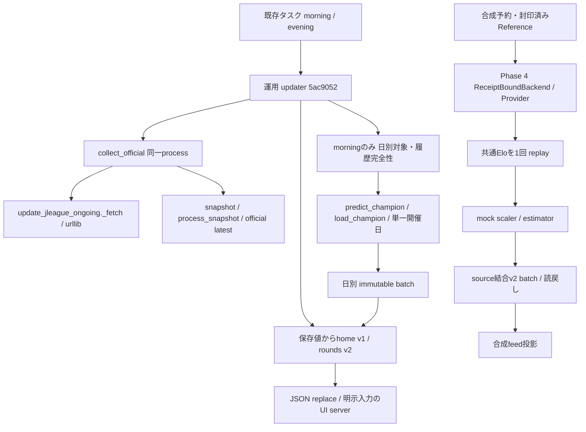

# Weekend Batch Phase 5A：実worker・実モデルの接続調査と隔離検証計画

判定：`PHASE5A_DESIGN_READY`。対象は設計・静的検証のみ。
基準は`feature/weekend-e2e-integration`の`af776d2c7569d491200ab96509047e7d8ea178fc`。
Phase 5A専用branchは`feature/weekend-phase5a-design`。Phase 4やmainへmergeしない。
Phase 4の613 PASS / 1 skipは**既存証跡**として照合し、今回再実行した件数へ加算しない。
今回の静的検証数、参照コードSHA、保護監査は[検証台帳](WEEKEND_BATCH_PHASE5A_VALIDATION.json)に記録する。

参照仕様：[Phase 1](WEEKEND_BATCH_PHASE1.md)、[Phase 2](WEEKEND_BATCH_PHASE2.md)、
[Phase 3](WEEKEND_BATCH_PHASE3.md)、[Phase 4](WEEKEND_BATCH_PHASE4.md)。
過去文書の「未接続」「未実装」は各phase時点の記録として保持し、現在の適合性は以下で区別する。

## 1. 現状構成と呼び出し経路

実タスクは引き続き運用専用worktreeの`5ac9052a221c6d8d563ec982bc48fbddb9e80bfa`を実行する。
07:00／22:00、InteractiveToken・Limited、IgnoreNew、StartWhenAvailable、ExecutionTimeLimit=15分。
予定時刻と実取得時刻は異なる。Phase 4のコードはこの実行先へ反映されていない。
タスクXML・実行状態・worktreeは読取りのみ。以下の図は**現在のコード経路**と**合成検証済み経路**を分ける。

Phase 4経路は実collectorを呼ばない。実タスクのmorningはcollector後に日別推論、eveningは公式更新と表示だけを行う。
現在のモデルはHTTP workerとして独立していない。モデル関数は同じupdater process内で呼ばれる。

実configはlookahead_days=2、source鮮度24時間、evidence上限20、取得予算600秒、discovery有効。
通常morningは当日〜2日先の最も早い未保存開催日を選ぶ。夜間に推論を追加する設定ではない。
保存・公開の相対位置は次のとおり（個人環境の絶対pathはprivate監査だけに保持する）。

| 領域 | 用途 |
| --- | --- |
| `runtime/acquisitions`、`runtime/snapshots` | 取得証拠、snapshot原本・manifest |
| `runtime/official/revisions/<revision>`、`runtime/official/latest.json` | 承認公式revisionと可変の参照pointer |
| `runtime/batches/<batch ID>` | canonicalな保存予測・binding・manifest。現運用は4日別batch、19件 |
| `runtime/view/champion_home.json`、`champion_rounds.json`、`update-status.json` | 表示用投影と状態。保存予測の正本ではない |
| 一時stage内の`data/processed/predictions/champion_a_prospective.csv` | canonical batchを合成したnative入力。元repoの保存CSVを追記・上書きしない |

feed CLIの既定入力は旧mixed保存CSVからChampion列を射影する経路であり、runtime batch readerの代替ではない。
週末nativeの表示はupdaterがcanonical読戻し後、prediction/binding/officialを明示して`champion_only=True`で構築する。
実CLI・feed builder・GUIは今回実行せず、UI側のJSON再読込配置も変更しない。

## 2. 接続契約表

本節の`path::symbol`は基準commitのコード参照であり、実行例ではない。

| 接続点 | 現行の引数・入力と出力 | 終了・上限・例外／接続上の制約 |
| --- | --- | --- |
| `scripts/update_champion_dashboard.py::main` | CLI `--config`、`--slot morning/evening`。source/runtimeを設定から解決、JSON状態出力 | success=0、catchしたException=1、argparse不正=2。通常CLIに週末backend capabilityは渡らず、有効化を拒否 |
| `scripts/update_champion_dashboard.py::collect_official` | source、runtime、config、binding用一時projection。raw/metadata、discovery、snapshot、公式revisionとlatestを書込む | Python例外を再送出しdiscoveryをfailed保存。独立Job/親worker deadlineなし。総取得予算120〜840秒、既定600秒、discovery最大12、evidence最大40のconfig境界 |
| `scripts/update_jleague_ongoing.py::_fetch` | URLと新規destination。HTMLと`.metadata.json`、request開始/fetched UTC、URL/status/bytes/SHA | 戻り値なし。socket=30秒、stream deadline=30秒、本文8 MiB、再試行loopなし。標準urlopenはredirect handlerを使用し得る。最終URL一致の事後検査はredirect GET自体の防止ではない |
| `scripts/update_jleague_ongoing.py::main` | `capture --listing-html`または明示`--fetch`、evidence、raw/output。`replay`もpublisherを呼ぶ | published=0、審査HOLD=2、例外は非0。cached/replayでもファイル・publicationを書込むため、Phase 5Aでは呼ばない |
| `src/modeling/champion_prediction.py::load_champion` | 固定5ファイル・data source SHA・metadataを検証後、joblib bytesをdeserialize | StandardScaler/LogisticRegressionの厳密type、1 feature、class/shape/finite検査。例外で停止。親process期限なし。ロード自体が実行可能オブジェクトの復元であり、静的hash照合だけで安全な実行を実証しない |
| `src/modeling/champion_prediction.py::predict_champion` | targets、official、source_root、now。masterと実artifact、百年構想履歴を読む | **単一開催日**を要求し、毎回履歴replay。週末10件を直接渡すと不適合。日別で4回呼ぶ方式も共通snapshot契約を満たさない |
| `src/modeling/champion_prediction.py::probability_rows` | artifact、7列targets、共通rating map → `(N,3)`の確率 | float `(N,1)`の差分を固定scaler.transform→model.predict_proba。fit・file保存・ネットワークの明示呼出しなし。ただし実artifactでの呼出しは今回は禁止 |
| `src/modeling/weekend_integration.py::ReceiptBoundBackend` | 合成Workspace、mock artifact、入力witness、Source Workspace、明示Reference | SYNTHETIC_ONLYのまま。実artifactを`synthetic_only=True`と偽装して通すことは禁止。新しい隔離契約が必要 |
| `scripts/update_champion_dashboard.py::publish_batch` / `src/modeling/weekend_batch.py::OfflineWeekendBackend.commit` | native予測CSV＋binding／全件snapshotとproof | 日別と週末の排他・重複拒否。後者は全件staging→rename。production scope未対応。既存runtimeへ呼ばない |
| `scripts/update_champion_dashboard.py::build_display_feeds` / `scripts/build_dashboard_feed.py::write_dashboard_feed` | saved CSV/bindingと公式revision → schema v1/v2 | builderは入力変化を検出。writerはJSONをreplace。builderから実予測は作らないが、実feedへの書込みは別承認 |

### 比較対象の研究用実HTTP worker

NN研究branch `42bd4050df5fef09f5e3887785056d0e69cec7c6`の
`research/nn_v2/phase2_5B_18/{collection_http_worker,collection_http_integration,collection_executor}.py`と
`research/nn_v2/phase2_5B_13/windows_local.py`を読取り・SHA照合した。**import・起動・permit再使用は0**。
これは運用collectorとも週末用workerとも別の封印済み研究実装である。

| 項目 | 研究実装で読み取れた契約 | 週末sourceへの差分 |
| --- | --- | --- |
| 入口 | worker `--task <file> <SHA>`。task/permit/code SHAと出力先を照合。正常main終了は0、例外は非0を親が拒否 | 旧109件permitは固定済み・消費済み。新しい運用用途へ転用しない |
| host/identity | `data.j-league.or.jp`、SFMS02と`data_site_match_id` | 運用sourceは`www.jleague.jp`の一覧・match page/discovery。HTML・URL・namespace・parserが異なる |
| 通信 | 証明書/hostname検証、socket/wall 10秒、親12秒、5秒以上間隔、retry/redirect/parallel=0、2 MiB/body | 運用_fetchの30秒・8 MiB・1秒待機と相違。Source archive上限2 MiBを緩めて接続しない |
| 入出力 | raw、request、metadata、worker/parent receipt、task/permit SHA、PID/Job、UTC/TLS | metadataは`response_completed_at_utc`。運用readerは`fetched_at_utc`。原本を改変せず別の版付きprojectionで対応を固定する設計が必要 |
| 所有権 | suspended create→Job所属→kernel PID/親PID/image照合→resume、kill-on-close、有限cleanup | 同様の設計を新用途で再検証する。Jobはread/write権限やネットワークのsandboxではない |
| 停止 | 通信・証拠異常は全体STOP。未知備考のみ隔離。旧permit消費・intentは接続前に保存 | 詳細収集の隔離成功を、週末履歴の完全性やadmissionへ転用しない |

Python audit hookとpath文字列の検査だけでは、native extension・悪意ある同一権限process・管理者からの
保護を立証できない。研究側の過去の実証結果も、本用途での実worker検証実績には数えない。
運用_fetchは独立したrequest.jsonを作らず、request開始UTCをmetadataへ記録する。研究workerとは
request SHA・TLS観測・保存完了receiptのschemaも異なる。通常HTTPS実装を使用していることと、
そのrunで証明書/hostnameを検証した証拠が保存されていることを同一視しない。

## 3. モデル・fixture・snapshot・IDの結合

Champion版は`operational_champion_20260922_v1`。bundle識別は`checksums.sha256`の固定SHA
`2d2e50dbfc4d71ec2cdaf5fe1a6e48953c160c388f1740cfe538f29f593646d1`。
個別5ファイル、metadata、2015〜2025の3,588件source、百年構想200件の固定SHAを読取りで再照合した。
metadata環境はPython 3.12.14、NumPy 2.5.3、pandas 3.0.5、scikit-learn 1.9.1、joblib 1.6.0。
現環境のdist-info表記は別の静的証拠として確認するが、import/ABI/deserialize/実属性/数値再現性は未検証。
自動更新・再fitを行う経路は対象予測関数には見当たらない。依存ライブラリ全体の副作用まで認定していない。

| ID／入力 | 関係と不変条件 |
| --- | --- |
| fixture | 公式fixture_key＋match_id_namespace＋match_id、TeamMaster両ID、日付/kickoff。namespace間の数値だけで同一視しない |
| reservation | `<Friday>.json`の期間・target全集合・元revision/manifest・作成UTCをSHA固定。水曜07:00前、部分既保存ならHOLD |
| source | 明示revision IDと公式manifest SHA。raw/metadata/request UTC、snapshot由来、全完了結果とreceipt/seal/Referenceを結合 |
| Source Provider ID | Reference、予約SHA、target集合SHA、実freeze UTC、policy/scopeのdigest。後続latestを入力に差し替えない |
| Elo snapshot ID | history-event SHA/count、rating map/SHA、全target特徴量、model/input/code/acquisition UTCを含むsnapshotのdigest |
| 予測入力 | `fixture_key,match_id,match_date,kickoff_time,home_team_id,away_team_id,match_id_namespace`の7列。結果列を受け取らない。モデルへはfloat `(N,1)`のelo_diffのみ |
| Elo仕様 | 初期1500、K30、HA175、resetなし。HAは履歴更新の期待値へ適用し、入力差分へ175を加えない。全対象で共通mapを読むだけ |
| 予測出力／ID | `(0,1,2)=Away/Draw/Home`、有限0〜1、和1。独立した新しいprediction UUIDは現行契約にない。native match_id＋model＋fixture binding＋生成UTCで保持し、aggregateでfixture/保存ID重複を拒否 |
| batch ID | 日別はソートfixture集合のSHA、週末はmanifest SHA付きdirectory名。fixture集合・source snapshot ID・batch IDを取り違えない |
| proof | Reference/receipt/seal、予約SHA、checkpoint UTC、Elo snapshot ID、入力特徴量SHA、出力CSV SHA。ローカル整合性であって外部署名ではない |

`src/modeling/champion_prediction.py::replay_ratings`は固定運用履歴をreplayする。
`src/features/elo_history.py`のID30700は既存運用の再開日処理のまま。NN研究の当初開始前特徴量や
別の時刻ポリシーへ無断で変更せず、本設計が研究側PIT監査を解決したとも扱わない。

## 4. Phase 4との適合・差分・未確認

| 要求 | Phase 4での状態 | 実接続の残件／判定 |
| --- | --- | --- |
| 予約→前夜receipt→共通Elo→10件→reader→feed | 合成E2Eで適合、既存37件の新規E2E証跡 | 実worker/実モデルでは未実証 |
| collectorを先に呼ばない | ReceiptBoundBackend分岐で適合 | 現実タスクの運用版は通常collector先行。不適合、配置変更は未承認 |
| 固定sourceとlatest applicability分離 | 適合。source/context/出力を公開直前まで検証 | 本番registryのread-only複製・更新競合・後続revision証拠の保持が必要 |
| before_prediction / before_save | 適合。実生成UTCを受け、逆行/期限/kickoffを再確認 | 実wall/monotonic観測、プロセスdeadline、外部時計異常の監視は別検証 |
| 07:00以前の確定source | 合成receiptで適合 | 保存運用例は07:00:30.807718 JST観測、07:00:41.691273 snapshot。元publication完了UTC不明で、そのまま金曜07:00用に使えない |
| 旧日別・旧v2・source結合v2 | 新readerで互換、旧readerは新形式を拒否 | 実運用readerは旧版のまま。deployment/rollback gateが必要 |
| 二重推論防止・部分既保存拒否 | attempt、lock、保存値照合により合成適合 | 実process kill/OS停止後の不明状態を自動再開しないことを別に実証 |
| 保存後feed失敗 | batchを保持し、reader再投影は推論0 | 実feed/GUIへの接続は未承認。二つのJSON全体のcrash原子性は未実証 |
| 原子的公開 | 同一volume directory renameを可視境界に使用 | directory metadata・電源断永続性・公開後receiptは未実証 |

履歴cutoffは金曜00:00 JST、information cutoffは07:00 JST。
取得・source公開/receipt検証≤07:00≤実freeze≤生成≤保存確認<全kickoffを要求する。
`Reference.ready_at_utc`はseal読戻し後の観測、Referenceファイルの作成・読戻しはその後の別段階である。
batchの`committed_at`もrename前の検査UTCであり、公開後receiptや電源断後の存在証明ではない。
mtime・予定時刻・後日のreceiptを過去の完了時刻へ代用しない。

## 5. 副作用と保護境界

| 処理 | 静的に確認した副作用／リスク | Phase 5B以降に必要な境界 |
| --- | --- | --- |
| import | 対象自作moduleにtop-levelのGET・joblib.load・task実行は見当たらない。Path.resolve、decorator、依存importはある | 通常Pythonはpycache/site初期化も行い得る。importを無害と仮定せず、承認済みbootstrap/dependencyを隔離する |
| `_fetch` / collector | DNS/TLS/HTTP、raw/metadata/discovery、snapshot/公式projection/latestへの書込み | 専用source worker、URL/host/回数/bytes/deadlineの明示固定。通常collectorを呼ぶ近道は禁止 |
| `load_champion` | bundle/data読取り、joblibによる実行可能object復元、依存nativeコード | 実モデルloadも別承認。ネットワーク不可・production非可視のOS隔離、全依存pin、resource上限 |
| updater | initialize、status、lock、diagnostics、一時CSV、batch、displayの作成/replace。任意retrospective分岐も存在 | production root/configを渡さない。pinned経路はretrospective設定を拒否。通常updater全体を安全なdry-runと呼ばない |
| publisher / feed writer | mkdir、create-new、fsync、rename/replace、handled failure時の一時file削除・復元 | 専用allowlist内の新規出力のみ。原本や本番runtimeを出力rootとして指定できない契約が必要 |
| GUI/server/launcher | server起動、loopback bind、ブラウザ起動は別入口で可能 | 今回はimport/起動しない。隔離試験もGUI/port/個人profile/既存serverへ接続しない |
| task登録 | `scripts/register_champion_update_tasks.ps1`は通常plan、明示Register時に実登録 | plan scriptも今回は実行しない。scheduler操作権限を検証workerへ渡さない |

Phase 5Aで行うのはstdlibによるテキスト/AST/JSON/XML読取り、SHA、Git・タスクのqueryのみ。
実collector、research worker、実モデル、GUI、publisher、feed builderは呼び出さない。
実モデル5ファイル・NN seal/53 payload・既存19予測、公式source、Desktop、全既存worktree・taskを保護する。

## 6. 隔離アーキテクチャ案（未実装・未承認）

推奨は**破棄可能な別Windows VM／非特権account**。production volumeやユーザーprofileを共有せず、
ネットワークはVM外側で遮断する。アプリ内mockやPython audit hookだけを遮断の証明にしない。
本番hostのfirewallや既存07:00/22:00タスクは変更しない。

1. 親controllerが承認されたcode/dependency/executable/model/input SHAとscopeを固定する。
   `SYNTHETIC_ONLY`を保持し、将来の実モデル隔離用scopeは別enum/readerで設計する。
   `ISOLATED_REAL_MODEL_VERIFICATION_ONLY`は**候補名**であり、本番scopeでも有効化スイッチでもない。
2. sourceは固定revisionを原本からread-onlyコピーし、全SHAとrequest/receiptの来歴を再照合する。
   コピー後のlatestは独立した適用可能性入力。collectorも研究の隔離packetも履歴に混ぜない。
3. 実モデル許可時だけ固定5ファイルと必要source/依存を新規read-onlyコピーする。
   artifactを上書き・自動download・refitしない。モデルworkerは入力特徴量と固定IDだけを受け取り、
   予測保存・source収集・task/GUI APIを持たない。データをpickle IPCで渡さない。
4. processはsuspended起動→Job割当→kernel identity/image SHA確認→resume。
   isolated bootstrapは環境変数・user-site/PYTHONPATH・bytecode cacheを抑止し、承認codeの検索pathだけを設定する。
   `-I/-B`だけでOS隔離が完了したとは扱わない。
5. 受渡しは版付きJSON/CSVとSHA。入力bytes/件数/float列/class順/URL/revision/receipt IDを親で検証し、
   stdout/stderrもサイズ上限を持つ。workerに渡すoutputはexclusive-create済み専用directoryだけ。
6. ACL/owner、reparse/Junction/symlink、handle identity、親path差替え、同一volume、既存file衝突を確認する。
   各書込みのfsync/readback/SHAと親receiptを確定するまで次状態へ進まない。
7. deadlineは親が単調時計で有限に管理する。候補はmodel load 60秒、推論30秒、cleanup 2秒＋
   残存確認5秒、全体600秒以内。これらは**未計測の試験上限案**であり、金曜07:00の情報cutoffを延長しない。
   source通信workerのsocket/親deadline/GET上限はHTTP承認工程で別固定する。
8. キャンセル・異常終了では自分のJobだけを停止し、OS exit、active数、task/input/output SHA、
   未確定bytesを保存する。owner不明なら停止要求を広げずBLOCKED。lock強制回収・自動再推論は禁止。
9. model出力は隔離結果に留め、production batch/feedには渡さない。検証用writer/readerは別scopeを
   強制し、通常運用readerはそれを拒否する。本番導入は別契約と別承認で行う。

監査receiptにはrun/request/task ID、scope、code/dependency/model SHA、公式revision/manifest、
Reference/receipt/seal、予約/target/input SHA、PID/kernel親/image/Job、開始/終了UTCとmonotonic、
timeout/exit/cleanup、出力SHA/bytes/class、公開段階、readback、terminal状態を記録する。
絶対path・raw・個人情報・予測値はprivateに保持し、公開版には集計・仕様・SHAだけを残す。

## 7. 必要な変更ファイル・実装順序と段階ゲート

以下は予定であり、今回コードを追加していない。既存Phase 4の安全gateは維持する。

| 段階 | 実装候補／確認内容 | 次へ進む条件と承認 |
| --- | --- | --- |
| G0：契約固定 | 新規隔離schema/controller/worker仕様。実source workerとmodel workerを分割。候補`weekend_isolation.py`、`weekend_model_worker.py`、新receipt schema | scope、ID/取得UTC、全入力SHA、output allowlist、OS制限、非公開backup、数値許容差を承認。まだ起動しない |
| G1：合成結合 | 新規tests。正常・拒否・不足receipt・変更source・generation時刻・二重起動・保存前後障害・feed復旧、旧日別/旧v2/派生v2を再回帰 | 合成fixture/mock artifactだけで全PASS。SYNTHETIC_ONLYは実artifactを拒否。既存613件とskipを区別 |
| G2：ローカルprocess | 隔離controller/Windows保存・Job層を新用途で実装。ネットワーク不可、mockモデル、保存byte responseだけ | VM/ACL/所有権/親終了/timeout/キャンセル/残存/receipt/deny-write/deny-networkを実OSで確認。実HTTP・実joblibは0。**推奨Phase 5B範囲** |
| G3：実モデル隔離 | 固定loader＋`probability_rows`の新worker接続。7列fake targetsと合成共通Eloのみ。実fixture/resultを投入しない | 別の明示承認後に、load成功・type/shape/classes・transformのみ・順序不変・同一入力反復・fit0・外部副作用0を確認。性能評価はしない |
| G4：実source worker | 新host/parser/metadata projectionを持つ取得専用worker。`weekend_source`の新scope/provider/receipt readerを別実装 | 別のHTTP承認で正確な対象/回数/robots/timeout/interval/body/親期限を固定。旧permit再利用なし。少数pilotとcutoff前公開の実receiptが必要 |
| G5：公開耐障害 | 新しいisolated publisher/post-commit receipt、互換reader、source registry、display generation | VM crash・電源断計画の承認と実証。batch確定とfeed確定を分離。productionへの投影はまだ禁止 |
| G6：本番移行 | 新backendを運用分岐へ接続する変更、reader配備、将来予約、source確保、予測、feed/UI更新 | 全未保存週末、予約期限、全履歴完全性をその時点で検証し、各操作を別承認。22:00へ推論を追加しない |

`src/modeling/champion_prediction.py`の単一日入口は維持し、共通Elo生成と固定artifactの推論を別workerへ
接続する。`weekend_source.py`・`weekend_batch.py`・`weekend_integration.py`の既存合成scopeを単純変更しない。
`scripts/update_champion_dashboard.py`やtask設定への接続はG6以降。旧research executorの再実行は全段階で禁止。

G3の数値比較対象、依存payload固定範囲、G5のstorage/NTFS/仮想disk構成と合格閾値は、実試験前に
個別計画として確定する。未計測の期限や一致許容差を成功保証として使わない。

## 8. Windows電源断耐性の検証計画

Phase 5Aではkill・OS停止・電源断・storage faultを注入しない。過去の合成故障は実電源断試験ではない。

| 境界 | 現在コードから分かる保証／不足 | 別環境での試験計画 |
| --- | --- | --- |
| attempt/consumed intent | 事前記録。研究workerはCREATE_NEW/FlushFileBuffers/readback。Phase 4はxb/flush/fsync/readback | 作成前後のprocess kill、再起動後のintent残存・重複拒否。intent不明でも無断再実行しない |
| raw/metadata/staging | `_fetch`はxb書込みのみで明示fsync/readbackなし。公式publisherの`_write_new`と週末write_newはfsyncする | 各file途中/close前後のkill、欠損・SHA不一致をSTOPにできるか。弱い取得原本を強いreceiptと偽装しない |
| source公開 | 全payload検証→directory rename→全readback→完了UTC→receipt→seal→Reference | 各境界のkillとVM強制停止を分け、公開済みreceipt欠落をHOLDで保存。元publication時刻を遡及しない |
| batch公開 | staging全検証＋lock＋rename。manifest COMMITTED/committed_atはrename前検査 | rename前/後・post-commit receipt前/後で試験。見えるgroupとreceiptの齟齬を不明状態に分類し、再推論しない |
| directory metadata | directory rename後のmetadata永続化やdevice cacheの電源断保証は未実証 | 同一volume/NTFSと仮想disk/cache/host設定を記録。VM停止と物理電源断を別の証拠として扱う |
| feed公開 | 各JSONはfsync＋replace。2 file間はhandled rollbackのみ、同時crash transactionではない | batch保持、last-good generation、status更新前後を確認。表示復旧だけ行い、推論・batch削除0を検証 |

安全な実機計画は、backup・復元済みの専用VMから開始し、本番volume・共有folder・task・ブラウザを
接続しない。合成payloadのseedとSHA、停止境界、OS/storage/VM設定、外側観測時刻を固定して反復する。
process kill、VM強制電源OFF、guest OS停止、host停止、物理storageの電源断は別カテゴリーで集計する。
VM試験で実物のcontroller/cache耐性を合格にしない。物理試験は専用機・破棄可能diskに限定して別承認を受ける。
起動後はまずread-only検査し、partial fileや孤立stagingを削除せず、caseごとの結果を保持する。
backupのCRC/SHA/独立展開一致も永続化保証そのものとは区別する。

## 9. STOP条件とrollback

| 状態 | 必須対応 |
| --- | --- |
| root/ACL/owner/Job・scopeが不明、保護差分、model/source/receipt SHA・identity・結果が不一致 | 全体STOP。勝手なrepair、source差替え、通常更新の推定は禁止 |
| 情報取得/公開が07:00超過、未完了履歴、時計逆行、期限超過、kickoff経過、日程/対象集合変更 | HOLD。cutoff延長・過去UTC補完・結果仮定をしない |
| HTTP 403/429、TLS/redirect/アクセス条件不明、消費状態不明、回数超過 | 全体STOP。GET再試行や別hostへのfallbackをしない |
| 未知備考だけで事実・証拠整合が成立 | source収集では隔離候補。ただし週末履歴採用・完全性・モデル入力へのadmissionは別審査。未解決履歴を抜いて推論しない |
| 公開前の失敗 | 予測公開0件、attempt/stagingを保存。自動再開・lock回収なし |
| rename済みでreceipt不明／OS停止後の状態不明 | 公開0件とは断定しない。read-onlyで全group・inventory・receiptを照合してHOLD。再生成・削除しない |
| 保存成功後のfeed失敗 | 予測を保持、last-good表示。承認後のreader再投影だけで復旧し推論0 |

rollbackは新規writerの入口停止と互換reader/last-good表示への退避を別承認で行う。
既存batch、原本、予約、HOLD、receiptを消さず、v2を旧日別へ変換しない。
予約解除と日別再開も部分既保存・二重保存を再照合して別承認とする。
現在の10/24保存済み5件、10/25未保存5件に週末方式を後付けせず、再計算・補完しない。

## 10. 今回の検証とPhase 5Bへの承認事項

変更対象はこの文書と検証台帳だけ。production module・テストコード・task・runtimeの変更はない。
静的検査は定義参照、呼出し契約、既存gate、SHA、旧JUnit、文書の相互参照・禁止事項を確認する。
最終静的検証は**69項目PASS**。動的テスト再実行・実worker/モデル試験は0。
コードをimportせずASTとして読むため、これはモデル/worker/OS sandboxの動作試験ではない。
Phase 4の8変更ファイルは固定SHA照合する。613 PASS/1 skipを新規PASSとして再計上しない。
新baselineは44,370保護ファイル（Phase 4の43,780＋Phase 4 worktreeの590 tracked file）を含む。
NNの53 payloadと実保存19予測、task XML/状態、全旧worktreeを終了時にも再照合する。

Phase 5Bに推奨する承認は**G0〜G2の合成実装・隔離されたローカルprocess検証だけ**。
VM/一時領域・code/executable/依存SHA、scope、mock入力、Job所有権、ACL/deny-write/deny-network、
有限期限とキャンセル・receipt・不明run非再開・backup範囲を事前固定する。
実model load/predictはG3の追加承認、実HTTP/robotsはG4の個別permitと追加承認、
破壊的障害注入はG5の別承認、本番予約・task/runtime配備・実予測・feed/UIはG6の別承認が必要。

`PHASE5A_DESIGN_READY`は、これらの欠けている実装・実証が完了したという判定ではない。
接続差分と保護境界、fail-closedの設計、次段階gateを明示できたという設計判定である。
Phase 5Aの公式GET、実worker起動、モデルload/fit/推論/評価、実予測保存、実feed更新、
実予約、task実行/変更、Desktop変更、既存file削除/上書きはいずれも0。
