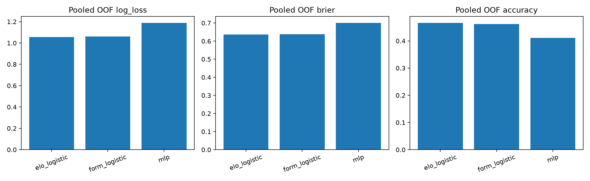
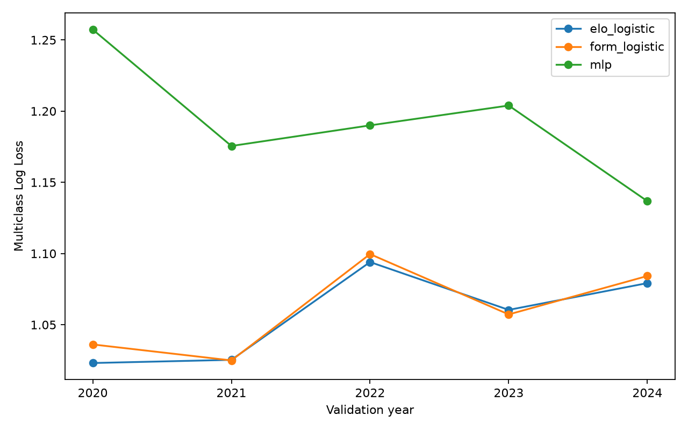
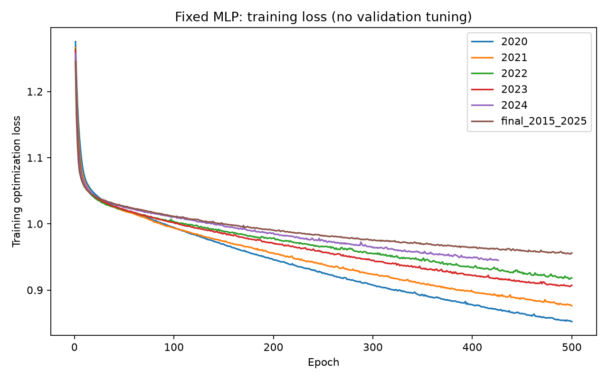

# NN研究 Phase 1.2 結果: 固定仕様の実データ学習・評価完了

2026-10-19実施。実行は1回、再試行0回、実process exitは0。研究処理と保存検証は完了したが、MLPの性能は2種類のLogisticを下回った。Champion Aへの採用・運用接続は行わない。

この文書がPhase 1.2の実行結果である。親のSTATUS.md、仕様、実装SHA台帳、Phase 1.1監査は学習前の固定記録として変更せず保持した。そこにあるfit 0回はPhase 1.1終了時点を示す。

## 固定条件と実行回数

- 学習したコード: 232546ef38bebe55e3847f2cd0d25a09c57ca961。
- Python 3.12.14 / scikit-learn 1.9.1 / CPU 1 thread。ライブラリ詳細はrun-receipt.json。
- 時刻ポリシー: nn_original_kickoff_events_v1_1。全3モデルで同じ特徴量。ID30700は当初開始前特徴量、最終Draw、結果反映は11月23日から。元CSVの日付は不変。
- 元データ2015〜2024: 3,208試合。Expanding Window 2020〜2024: 各モデル1,678 OOF試合。
- 5fold × 3モデル = 15 historical fits。foldごとにScalerとモデルを新規学習。
- 歴史評価成功後、2015〜2025の3,588試合で最終研究用MLPを1回学習。2024年380試合、ID重複0。
- 2025は使用済みtestで、最終fitだけに使用。2025性能評価・モデル選択は0回。2026データ・ST2・後日再現予測は未使用。
- 9特徴量、MLP(32,16)、ReLU/Adam、alpha=0.01、lr=0.001、seed=42、max_iter=500、early_stopping=Falseを維持。パラメータ変更・選び直し・再学習なし。
- 外側実行開始（UTC）: 2026-10-19T05:29:40.003309+00:00。完了（UTC）: 2026-10-19T05:30:01.380205+00:00。
- 最終モデル保存時刻（UTC）: 2026-10-19T05:29:58.278159+00:00。過去の試合前保存予測ではない。

## Pooled比較

Log LossとBrierは小さいほど良い。Brierは3クラス二乗誤差の和を試合平均した値。Accuracyは参考値。

| モデル | OOF試合数 | Log Loss | Brier | Accuracy |
|---|---:|---:|---:|---:|
| Elo-only Logistic | 1678 | 1.056063738 | 0.635731118 | 46.6627% |
| 9特徴量 Logistic | 1678 | 1.059921363 | 0.638142044 | 46.1859% |
| 9特徴量 MLP | 1678 | 1.189486276 | 0.701244413 | 41.1204% |

MLP − 比較モデルの差（正のLog Loss/Brier差は悪化）:

| 比較対象 | Δ Log Loss | Δ Brier | Δ Accuracy（ポイント） |
|---|---:|---:|---:|
| Elo-only Logistic | +0.133422539 | +0.065513295 | -5.5423 |
| 9特徴量 Logistic | +0.129564914 | +0.063102369 | -5.0656 |

**MLPの有意な優位性は実証されていない。** 今回は全foldでMLPのLog Lossが両Logisticより大きく、成績が悪かった。事後の有意差検定やチューニングは追加していない。
2020〜2024は既に研究使用済みであり、未使用holdoutでも将来性能の保証でもない。公式キャッシュの後日掲載情報は当時の公開状態を立証しない。

## 年度別評価

| 年度 | 学習試合数 | 評価試合数 | モデル | Log Loss | Brier | Accuracy | 秒 | 反復 | 収束警告 |
|---|---:|---:|---|---:|---:|---:|---:|---:|---|
| 2020 | 1530 | 306 | elo_logistic | 1.023119735 | 0.611757222 | 50.6536% | 0.0531 | 4 | なし |
| 2020 | 1530 | 306 | form_logistic | 1.036160951 | 0.619965365 | 49.6732% | 0.0130 | 17 | なし |
| 2020 | 1530 | 306 | mlp | 1.257282167 | 0.712696834 | 41.1765% | 1.0064 | 500 | あり |
| 2021 | 1836 | 380 | elo_logistic | 1.025343721 | 0.614982914 | 50.7895% | 0.0119 | 4 | なし |
| 2021 | 1836 | 380 | form_logistic | 1.024941643 | 0.613690820 | 51.5789% | 0.0150 | 14 | なし |
| 2021 | 1836 | 380 | mlp | 1.175537439 | 0.695791702 | 45.0000% | 1.2178 | 500 | あり |
| 2022 | 2216 | 306 | elo_logistic | 1.094018639 | 0.661022434 | 40.1961% | 0.0115 | 4 | なし |
| 2022 | 2216 | 306 | form_logistic | 1.099605433 | 0.665039392 | 41.1765% | 0.0126 | 12 | なし |
| 2022 | 2216 | 306 | mlp | 1.190005902 | 0.719944739 | 34.6405% | 1.4636 | 500 | あり |
| 2023 | 2522 | 306 | elo_logistic | 1.060428557 | 0.638530529 | 46.0784% | 0.0115 | 4 | なし |
| 2023 | 2522 | 306 | form_logistic | 1.057240123 | 0.637071006 | 46.4052% | 0.0134 | 12 | なし |
| 2023 | 2522 | 306 | mlp | 1.203942484 | 0.703504052 | 41.1765% | 1.6420 | 500 | あり |
| 2024 | 2828 | 380 | elo_logistic | 1.079233834 | 0.653164189 | 45.0000% | 0.0116 | 4 | なし |
| 2024 | 2828 | 380 | form_logistic | 1.084237450 | 0.656433302 | 41.8421% | 0.0146 | 13 | なし |
| 2024 | 2828 | 380 | mlp | 1.136782093 | 0.680596623 | 42.3684% | 1.5807 | 426 | なし |

## 収束・保存

MLPの2020〜2023 foldは各500反復でConvergenceWarning、2024 foldは426反復で警告なし。最終MLPも500反復でConvergenceWarning。
最終fit所要時間は 2.2457 秒。固定budgetの有限な学習は警告を記録して保存する契約であり、警告を消すための再学習は行っていない。研究用artifactは保存されたが、最終モデルの収束は未確認である。

旧Champion Aの凍結済みLog Loss 1.056065401323764は参考値。新時系列Elo-onlyは1.056063737594059で、差は−0.000001663730。ID30700の時刻処理が異なるため一致を必須にせず、正式ベンチマークは変更していない。

## 検証と保護

- 関連テスト108 PASS。学習入口の実process exit 0、実行1回・再試行0回。
- OOF 5,034行（1,678 × 3）の試合・fold・クラスラベルが全モデルで一致。保存済み確率から3指標を別途再計算してCSVと照合。
- 確率は有限・0〜1・合計1。クラス順序0=Away、1=Draw、2=Home。
- fold別Scalerの学習件数は1530 / 1836 / 2216 / 2522 / 2828。最終Scalerは3588件。
- モデル／Scalerを読み戻し、クラス・重み・スケール値・固定パラメータ・SHA・学習manifestを確認。最終モデルを2025データで評価していない。
- 生成ファイル26件とSHA台帳のファイル集合・サイズ・SHAをreadback確認。
- 入力12件、公式キャッシュ3,588件・metadata3,588件、研究実装・固定文書18件が不変。未知の時刻例外0。
- 保護対象560ファイルが学習前後で不変。運用runtimeの非profileファイル集合も同一。保存済み14予測、後日再現98試合、表示ストア、Champion A、正式ベンチマークは維持。
- タスク2件の定義と有効状態、運用worktreeのHEAD/clean状態、mainを維持。外部config・既存サーバーに操作なし。個人ブラウザープロファイルは対象外。
- Phase A: BLOCKED / Phase B: NOT_AUTHORIZED。

## 成果物と復元

ローカル出力（WindowsのLocalAppDataを起点とする）:

%LOCALAPPDATA%/J1AI/NNResearch-phase1_2-20261019-142912/run

- fold-metrics.csv、pooled-metrics.csv、oof-predictions.csv。
- training-curves.json と3種のPNGグラフ。
- artifact/model.joblib、artifact/scaler.joblib、artifact/metadata.json、artifact/training-manifest.csv。
- SHA256-MANIFEST.json、result.json、監査・時刻イベント・入力来歴。
- 親フォルダに学習前後照合、外側exit、ログ、固定仕様とコードのコピーを保存。

- Model SHA-256: 30b159ed8cb6da84f210def283ab2c242073463c4895ac8d279adc5c03e8f55a
- Scaler SHA-256: dada7aab10cb8cf706bd96fed311edd262a2ee167162464137bac563c4985c0b
- Run SHA台帳 SHA-256: f2438b10c7f630bbc71e4a8150bb4a992b06cd88a9a92d327240c23cdf6b37ea

GitHubにはこのレポート・集計CSV・グラフ・安全な実行receipt・成果物SHA台帳のみ保存する。モデル、行別OOF、ローカル設定、個人パスを含む保護receipt、原データは追加しない。
バックアップは研究ディレクトリを別ドライブの新規ZIPへ保存し、全entryのSHAとCRCを読み戻し照合する。学習入力CSVと公式根拠3ページのコピーも同梱する。公式キャッシュ3,588件の本体は研究ZIPの対象外であり、再実行には別途同じSHAの元キャッシュと入力環境が必要。
復元時はZIPのSHAを確認して新規フォルダへ展開し、BACKUP-MANIFESTとrun/SHA256-MANIFESTのサイズ・SHAを照合する。joblibは信頼できる自作artifactのみ、記録済みライブラリ版で読み込む。復元検証に再学習・運用設定変更は不要。

## 次の判断

固定した初回研究を完了した。NN採用は推奨しない。追加実験を行う場合は、新しい仕様・評価計画を事前に固定して別工程で承認を受ける。今回の結果を見て同じ検証期間に合わせた再調整は行わない。
