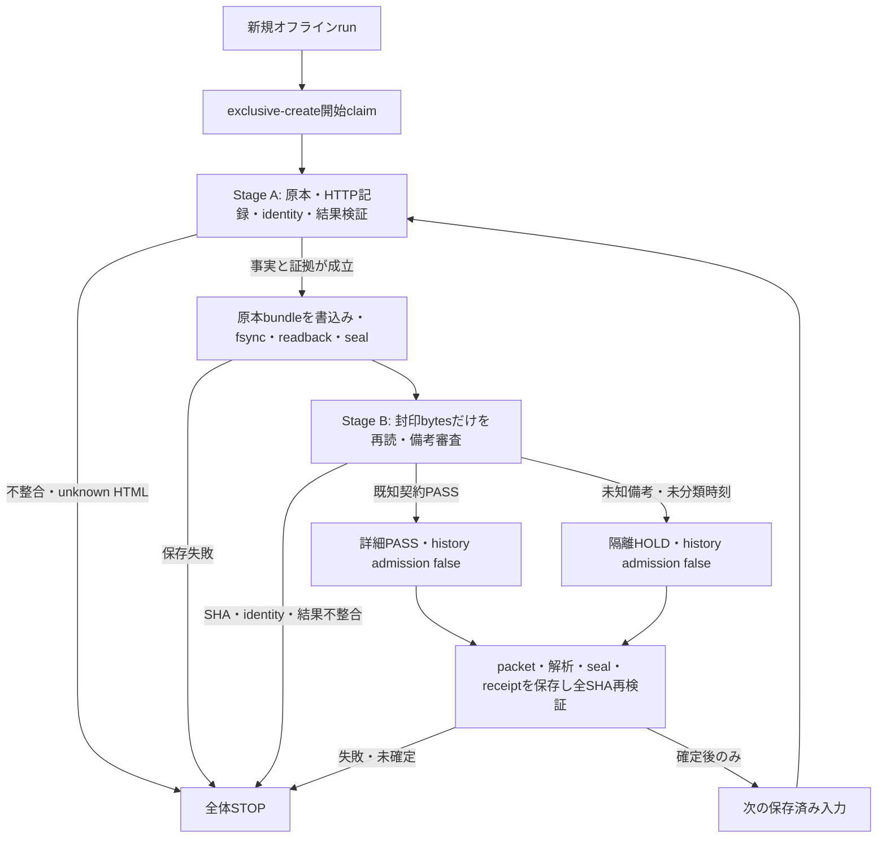

# 状態遷移と停止境界

停止したrunも異常終了したrunも、開始claimの存在により再実行を拒否する。停止後に残る入力へ進まず、再開用の入口を持たない。raw、metadata、request、sealとreceiptは上書きしない。

Stage Aで原本封印が完了しStage Bが備考HOLDとなることは、全体STOPとは区別する。隔離receiptを確定できる場合だけ後続のオフライン処理を続行する。Stage Aでidentityや結果を検証できない異常を、備考HOLDに置き換えない。Stage Bでも同じstrict結果を要求し、不整合を隔離対象として隠さない。

取得状態、詳細解析状態、隔離状態、時刻証拠状態、履歴採用状態を分ける。正常終了や詳細全件PASSもHISTORY/PREDICTIONのREADYを意味せず、隔離中の試合を無視した履歴出力も行わない。
